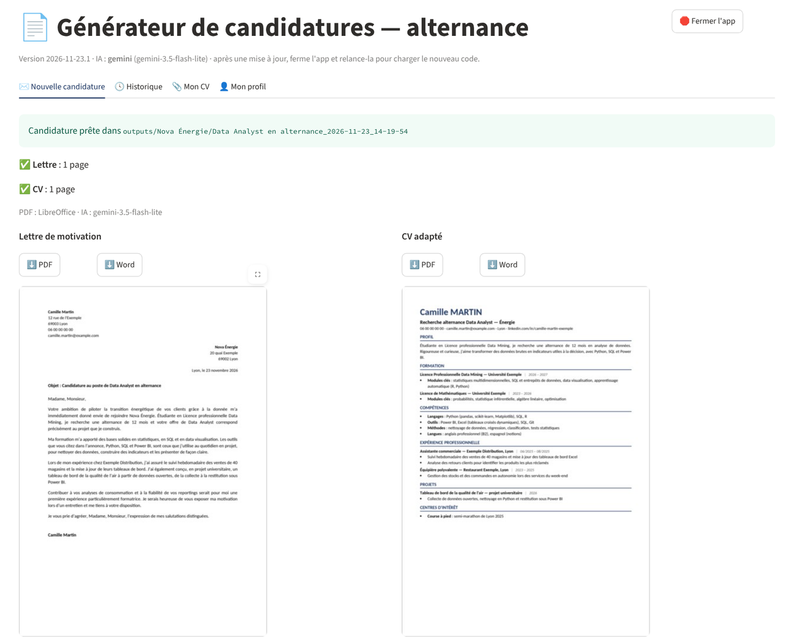

# Générateur de candidatures — alternance

[](https://github.com/Levraiowen/Recherche-alternance/actions/workflows/tests.yml)

App locale (Streamlit) pour préparer en une minute une candidature
personnalisée à partir d'une offre d'alternance :

1. Tu importes ton CV Word une fois (il reste enregistré en local).
2. Tu colles le texte d'une offre.
3. L'app génère, en **PDF prêt à envoyer, chacun sur une seule page** (le
   .docx est aussi gardé) :
   - une **lettre de motivation** au format A4, nommée
     `Lettre_Motivation_Prénom_Nom_(Entreprise).pdf` ;
   - une **version adaptée de ton CV**, nommée `CV_Prénom_Nom_(Entreprise).pdf`,
     avec quelques formulations ajustées pour coller à l'offre — même mise
     en page, même fichier d'origine, mise en forme conservée (libellés en
     gras, dates en italique...).
4. Tu relis (aperçu intégré), tu retouches si besoin directement dans l'app,
   tu télécharges, tu envoies.



## Ce que ce projet met en pratique

- **Intégration d'une API IA** (Google Gemini, sortie JSON structurée par
  schéma) avec bascule automatique entre plusieurs modèles quand l'un
  atteint son quota ou est retiré, et fournisseur alternatif (Claude)
  interchangeable sans toucher au reste du code.
- **Mise en page garantie sur une page** : le PDF réellement produit est
  analysé (nombre de pages, hauteur du contenu qui déborde) et le document
  est resserré juste ce qu'il faut — espacements, interligne, marges, puis
  seulement en dernier recours la taille de police — en visant le bon
  niveau dès le premier essai d'après la mesure du débordement.
- **Manipulation fine de documents Word** (python-docx, lxml, docxtpl) :
  édition ciblée d'un paragraphe en conservant la mise en forme de chaque
  segment, respect de l'ordre des balises imposé par le format OOXML,
  gabarit de lettre généré par code.
- **Pipeline de conversion PDF à plusieurs niveaux de repli** (Microsoft
  Word via COM → LibreOffice en ligne de commande → service cloud), avec
  détection des pannes plutôt que des blocages silencieux (délai borné,
  nettoyage de l'arbre de processus, diagnostic clair).
- **Robustesse et données** : écritures JSON atomiques, récupération après
  corruption, dossiers de sortie isolés par génération, historique
  consultable avec détection des candidatures en double.
- **Qualité logicielle** : 36 tests automatisés (pytest, dont un test de
  l'interface Streamlit de bout en bout et un test d'intégration avec un
  vrai moteur de rendu), analyse statique (ruff), intégration continue
  GitHub Actions.
- **Déploiement pour un utilisateur non technique** : lanceur Windows qui
  crée l'environnement et installe/met à jour les dépendances tout seul,
  raccourci avec icône épinglable à la barre des tâches, fermeture propre
  depuis l'interface.

## Installation

Prérequis : **Python 3.10 ou plus récent** (sous Windows, cocher « Add
python.exe to PATH » pendant l'installation).

**Sous Windows, rien à taper** : double-clique sur `Lancer.bat`. Au premier
lancement, il crée l'environnement Python (`.venv`) et installe les
dépendances ; ensuite, il ne les réinstalle que si `requirements.txt` a
changé (après une mise à jour du projet, par exemple).

Installation manuelle (toutes plateformes) :

```bash
python -m venv .venv
.venv\Scripts\activate          # Windows (PowerShell : .venv\Scripts\Activate.ps1)
source .venv/bin/activate       # Mac / Linux
pip install -r requirements.txt
```

## Configuration de la clé API (gratuit par défaut)

Par défaut, l'app utilise l'**API Gemini** (Google) pour rédiger la lettre et
adapter le CV — gratuit, sans carte bancaire, indépendant d'un éventuel
abonnement Gemini payant.

1. Crée une clé gratuite sur
   [aistudio.google.com/apikey](https://aistudio.google.com/apikey) (connexion
   avec un compte Google, aucun paiement demandé).
2. Copie `.env.example` en `.env` dans le dossier du projet.
3. Colle ta clé dans `.env` :
   ```
   FOURNISSEUR_IA=gemini
   GEMINI_API_KEY=...
   ```

Le fichier `.env` n'est jamais partagé ni commité (il est listé dans
`.gitignore`).

**Modèle et quotas :** l'app utilise `gemini-3.5-flash-lite` (quota gratuit
généreux) et bascule automatiquement sur `gemini-3.1-flash-lite`, puis
`gemini-3.8-flash` et `gemini-3.6-flash` si le quota du jour est atteint ou
si Google retire un modèle. Tes limites exactes sont visibles sur
[aistudio.google.com](https://aistudio.google.com) ; le détail des modèles
sur [ai.google.dev/gemini-api/docs/models](https://ai.google.dev/gemini-api/docs/models).
Pour forcer un autre modèle : `GEMINI_MODEL=...` dans `.env`.

**Alternative payante (Claude/Anthropic) :** passe `FOURNISSEUR_IA=anthropic`
dans `.env` et ajoute `ANTHROPIC_API_KEY=sk-ant-...` (clé à créer sur
[console.anthropic.com](https://console.anthropic.com), facturée à l'usage :
environ 3 centimes par candidature avec Claude Sonnet 5.5, le modèle par
défaut, et environ 0,2 centime avec `ANTHROPIC_MODEL=claude-haiku-5-5`).

## Lancer l'app

**Option simple (recommandée) : un raccourci à double-cliquer**

1. Double-clique une seule fois sur `Creer_raccourci.vbs` (script Windows
   natif, rien à installer). Il crée un raccourci **« Candidatures
   Alternance »** sur le Bureau, avec sa propre icône.
2. Ensuite, pour lancer l'app : double-clique sur ce raccourci.
3. Pour l'avoir dans la barre des tâches : clic droit sur le raccourci du
   Bureau → « Épingler à la barre des tâches ».

Une petite fenêtre noire reste ouverte pendant que l'app tourne : elle
affiche les éventuelles erreurs. Pour arrêter l'app, utilise le bouton
**🛑 Fermer l'app** en haut de la page (ou ferme la fenêtre noire).

**Option manuelle (ligne de commande)**

```bash
streamlit run app.py
```

Dans les deux cas, un onglet s'ouvre dans ton navigateur (par défaut
http://localhost:8501).

## Utilisation

- **✉️ Nouvelle candidature** : colle l'annonce, précise si besoin
  l'entreprise, le poste et son adresse, puis clique **une seule fois** sur
  « Générer la candidature ». L'app rédige le contenu, crée les fichiers Word,
  les convertit en PDF d'une page et affiche :
  - le statut de chaque document (1 page, et le cas échéant le léger
    resserrement appliqué), la méthode de conversion et le modèle d'IA utilisés ;
  - les boutons de téléchargement, un **aperçu** de chaque PDF et un bouton
    pour ouvrir le dossier ;
  - une zone **« Relire et retoucher »** : objet, paragraphes, formule de
    politesse et chaque modification du CV (activable/désactivable) sont
    modifiables, puis « Mettre à jour les fichiers » régénère Word + PDF
    sans rappeler l'IA.

  Chaque génération a son propre sous-dossier horodaté dans
  `outputs/<Entreprise>/` : rien n'est jamais écrasé. Si tu as déjà généré
  une candidature pour la même entreprise, l'app te le signale.
- **🕓 Historique** : toutes les candidatures générées, avec recherche,
  retéléchargement des fichiers et accès au dossier. Le bouton 🗑️ retire
  une entrée de la liste sans toucher aux fichiers.
- **📎 Mon CV** : importe ton CV au format **.docx**. Il devient la référence
  permanente : chaque candidature part d'une copie, il n'est jamais modifié.
  Tu peux voir les blocs de texte détectés (🔒 = jamais modifié par l'IA :
  coordonnées, liens, titres de section) et **vérifier qu'il tient sur une
  page**.
- **👤 Mon profil** : tes coordonnées (en-tête de chaque lettre) et ton
  contexte académique (utilisé par l'IA pour situer ta candidature).

## Une page garantie : comment ça marche

Un CV qui tient sur une page dans un logiciel peut déborder dans un autre :
chaque moteur de rendu (Word, LibreOffice...) calcule la hauteur des lignes
un peu différemment. L'app ne devine donc pas : elle **mesure le PDF
réellement produit**.

1. Le document est converti tel quel ; si le PDF fait une page, rien n'est
   touché.
2. Sinon, l'app mesure la hauteur du contenu passé en page 2 et choisit le
   plus petit niveau de resserrement qui devrait suffire, puis vérifie.
3. Les niveaux vont du moins visible au plus visible : espacements entre
   paragraphes et interligne (−2 % à −12 %), puis marges, et seulement
   ensuite la taille de police, par demi-point. **Le texte n'est jamais
   coupé.**
4. Pour le CV, le niveau qui a suffi est mémorisé : les candidatures
   suivantes partent directement du bon réglage (une seule conversion).

En amont, l'IA a pour consigne de ne jamais allonger un bloc du CV au-delà
de sa longueur d'origine (une adaptation nettement plus longue est
ignorée et signalée), et de viser 1 300 à 1 900 caractères pour le corps de
la lettre.

## Export PDF

L'app essaie automatiquement, dans l'ordre, la première méthode disponible :

1. **Microsoft Word** (version bureau installée) — 100 % local, le plus fidèle.
2. **LibreOffice** — 100 % local aussi, gratuit et illimité :
   [fr.libreoffice.org/telecharger](https://fr.libreoffice.org/telecharger/).
3. **iLovePDF** (service en ligne), si tu n'as ni l'un ni l'autre — configure
   `ILOVEPDF_PUBLIC_KEY`/`ILOVEPDF_SECRET_KEY` dans `.env` avec une clé
   gratuite créée sur [developer.ilovepdf.com](https://developer.ilovepdf.com)
   (2 500 crédits par mois, soit environ 250 conversions : une candidature en
   consomme 2, parfois 3 ou 4 si la mise en page doit être resserrée).
   **Ton CV et ta lettre sont alors envoyés aux serveurs d'iLovePDF le temps
   de la conversion.**

La méthode qui fonctionne est mémorisée pendant que l'app tourne. Si aucune
n'est disponible, les fichiers **.docx** restent téléchargeables.

## Où sont stockées les données

Tout reste **en local**, dans le dossier du projet :

- `data/cv_original.docx` — ton CV de référence
- `data/profil.json` — tes coordonnées
- `data/historique.json` — l'historique des candidatures générées
- `data/mise_en_page.json` — le réglage de mise en page mémorisé pour ton CV
- `outputs/<Entreprise>/<poste_date>/` — les fichiers générés (PDF + Word)

Au moment de générer une candidature, le contenu de ton CV et de l'annonce
est envoyé au fournisseur IA actif (Gemini par défaut, ou Anthropic), et à
iLovePDF seulement si c'est lui qui fait la conversion PDF. Bon à savoir
pour Gemini : sur le palier gratuit, Google peut utiliser les contenus
envoyés pour améliorer ses produits, **sauf pour les utilisateurs situés
dans l'Espace économique européen (donc en France), au Royaume-Uni et en
Suisse**, à qui s'appliquent les mêmes règles que pour le palier payant
(voir les [conditions de l'API Gemini](https://ai.google.dev/gemini-api/terms)).

## Limites connues

- **Formats acceptés pour le CV : .docx uniquement** (pas de PDF : un PDF ne
  peut pas être réédité en préservant sa mise en page).
- Le texte contenu dans des **zones de texte, images ou SmartArt** n'est pas
  détecté — seuls les paragraphes et tableaux Word « standards » sont lus
  et modifiables (vérifie la liste dans l'onglet « Mon CV »).
- La mise en forme d'un paragraphe modifié est conservée segment par segment
  (libellé, texte, date...) ; une mise en forme ponctuelle au milieu d'une
  phrase réécrite (un mot en gras isolé) peut toutefois être perdue.
- L'IA a pour consigne stricte de ne jamais inventer une expérience, un
  diplôme ou une compétence absente du CV — elle reformule et réorganise
  l'emphase. **Relis toujours** le résultat avant de l'envoyer : c'est toi
  qui restes responsable du contenu envoyé.

## Modifier la mise en page de la lettre

Ne modifie jamais `templates/lettre_template.docx` directement dans Word :
les balises qu'il contient (`{{ ... }}`) seraient probablement cassées.
Modifie plutôt `scripts/generer_gabarit_lettre.py` puis relance-le :

```bash
python scripts/generer_gabarit_lettre.py
```

## Tests

```bash
pip install -r requirements-dev.txt
ruff check .
pytest
```

Les tests utilisent un CV fictif généré à la volée et un dossier temporaire :
ils ne lisent ni ne modifient jamais tes vraies données. Le test
d'intégration de la mise en page utilise LibreOffice s'il est installé (il
est ignoré sinon) ; la CI GitHub Actions l'installe pour le lancer à chaque
push.

## Structure du projet

```
app.py                          interface Streamlit (4 onglets)
Lancer.bat                      double-clic pour démarrer (installe les dépendances si besoin)
Creer_raccourci.vbs             à exécuter une fois pour créer le raccourci Bureau
icon.ico                        icône utilisée par le raccourci
src/
  candidature.py                assemble lettre + CV adapté + PDF d'une page
  mise_en_page.py               mesure des PDF et resserrement progressif (1 page garantie)
  cv_editor.py                  extraction/édition du CV Word en conservant la mise en forme
  lettre_generator.py           rendu du gabarit de lettre (docxtpl) + typographie française
  pdf_export.py                 conversion .docx -> .pdf (Word, LibreOffice, iLovePDF)
  ai_client.py                  bascule vers le fournisseur IA actif (FOURNISSEUR_IA)
  ia_commun.py                  schéma, prompt et parsing partagés entre fournisseurs
  ia_gemini.py                  fournisseur Gemini (gratuit, par défaut)
  ia_anthropic.py               fournisseur Anthropic/Claude (payant, alternatif)
  stockage.py                   profil, historique, réglages (fichiers JSON locaux)
scripts/
  generer_gabarit_lettre.py     génère templates/lettre_template.docx
templates/
  lettre_template.docx          gabarit Word de la lettre (généré, format A4)
tests/                          tests automatisés (pytest)
docs/apercu.png                 capture d'écran pour ce README
data/                           CV, profil, historique (non versionné)
outputs/                        fichiers générés (non versionné)
```

## Licence

[MIT](LICENSE)
